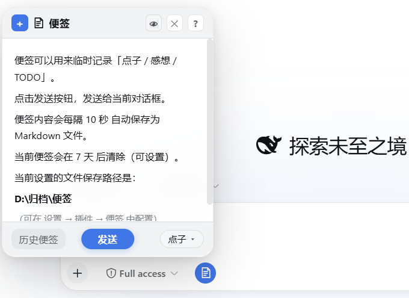

# dsh-sticky-note

[](https://github.com/deepseek-ai/deepseek-harness/releases/tag/dsh-v0.2.1-rc.5)

左下角便签：随手记点子 / 感想 / TODO，实时保存到归档目录，清单 + 悬浮归档。

> 当前版本 **v0.6.1** 兼容 DSH `0.2.x`（最低 `0.2.0-rc.2`，最新实测 `0.2.1-rc.5`）。包内已声明机器可读的 `engines.dsh` 范围，DSH 会在安装/加载前自动做兼容性检查；便签设置仍由插件 `Config` 自动写入当前 profile patch。



## ✨ 功能

- 📝 **随手记**：编辑框工具栏上的便签按钮，点击弹出便签面板
- 📍 **可选固定**：从标题栏操作中固定后吸附到屏幕边缘，外部点击不再关闭；固定状态与位置会被记住
- 🔁 **可选续写**：可在插件设置中选择重新打开时继续当前草稿；默认关闭，保持原有行为
- 🔎 **整体缩放**：标题栏操作提供 `− / 倍率 / +`，支持 `Cmd/Ctrl + + / - / 0`，倍率会被记住
- 💾 **自动保存**：按设定间隔（10 秒 / 1 分钟 / 5 分钟）自动落盘，`Ctrl+S` 立即保存
- 🏷️ **三分类**：点子 / 感想 / TODO，快捷键 `Ctrl+Shift+1/2/3` 切换
- 📤 **一键发送**：便签内容直接发给当前对话（或追加到输入框）
- 📋 **历史便签**：分组清单 + 展开收起，双击查看、单击预备发送，归档分组可一键恢复
- ✏️ **可编辑**：历史便签可二次编辑保存；外部编辑器改动后查看视图自动刷新
- 📌 **选择保留**：标记保留的便签不会被自动清除（针形图标）
- 🧹 **自动清除**：按最后修改时间计龄，超期未保留的先移入「已清除」回收站（保留 30 天），Host 定时触发
- 🖥️ **Markdown**：编辑 ↔ 实时预览（`Ctrl+Shift+V`），支持表格 / 任务列表 / 删除线 / 图片
- 🌓 **深色模式**：全部配色跟随 DSW 主题变量，深浅自动切换
- ⌨️ **快捷键**：`Esc` 层层退出、`Tab/Shift+Tab` 缩进、`Ctrl+Shift+X` 删除线、`Ctrl+Shift+T` 任务项、`Ctrl+T` 表格骨架等
- ⚙️ **可配置**：存储路径、保存间隔、清除周期、默认类别、发送方式、是否继续当前草稿

## 📦 安装

```sh
dsh plugin --profile web add github:Meredith2328/dsh-sticky-note
```

或本地目录：

```sh
dsh plugin --profile web add file:/path/to/dsh-sticky-note
```

安装后重启 DSH（Web 或 Desktop）。

> 请不要使用裸包名 `dsh plugin ... add dsh-sticky-note`；npm 上的同名包不是本项目。

## 🧩 版本对应与自动兼容

安装前可先运行 `dsh --version`，再按实际 DSH 版本选择插件：

| 便签版本 | 支持的 DSH 版本 | 建议 | 说明 |
|---|---|---|---|
| **v0.6.1（当前）** | `0.2.x`，最低 `0.2.0-rc.2` | ✅ 推荐 | 已验证至 `0.2.1-rc.5`；声明 `engines.dsh`，由 DSH 自动拦截不兼容版本 |
| v0.6.0 | `0.2.x`，最低 `0.2.0-rc.2` | 可用 | 已验证 `0.2.0-rc.2` 和 `0.2.1-rc.5`；未声明 `engines.dsh` |
| v0.5.0 / v0.2.4 | `0.1.0-rc.7` ~ `0.1.6-alpha.2` | 旧版 DSH | 使用旧版 settings 接缝，不兼容 DSH `0.2.x` |
| v0.2.2 ~ v0.2.3 | `0.1.0-rc.7` ~ `0.1.1-rc.2` | 旧版 DSH | 仅用于更早的 DSH 环境 |

当前 `v0.6.1` 的机器可读范围为：

```json
"engines": {
  "dsh": ">=0.2.0-rc.2 <0.3.0-0"
}
```

上面的上界包含用于排除 `0.3.0` 预发布版的技术哨兵，实际含义是“只接受 `0.2.x`”。DSH `0.2.1` 及以后会优先读取这个字段；不匹配时，插件管理器会在导入插件代码前拒绝安装或加载。DSH `0.2.0` 仍可回退使用 `peerDependencies` 中的版本范围。因此正常使用匹配版本时，不需要手工修改 `package.json` 或 profile 配置。

首次加载时，设置值来自插件的 `Config` 默认值；用户保存设置后，插件会自动把条目以 `dsh-sticky-note` 为 id 写入当前 profile 的 `cordis.patch.yml`。Read/Write、RPC 和插件详情页配置插槽继续沿用 DSH `0.2` 的接口。

本次兼容性检查在全新的 DSH `0.2.1-rc.5` Web profile 中完成：插件可安装并正常加载，便签按钮和面板可用，保存后重新打开能读回内容，设置页读写会正确落到 profile patch；浏览器控制台、页面脚本和 HTTP 请求均无报错。仓库的自动化测试也全部通过。

## 🗂️ 存储结构

```
<root>/
├── 点子/    ← 以时间戳命名的 .md 文件
├── 感想/
├── TODO/
├── 归档/    ← 归档的便签（前缀类别名，可一键恢复）
└── 已清除/  ← 自动清除的回收站（保留 30 天）
```

默认根路径 `~/.dsh/sticky-notes`（`DSH_HOME` 下），可在设置页修改。

## 🤝 贡献

外部贡献采用先 Issue、后 PR 的流程。请先阅读 [CONTRIBUTING.md](CONTRIBUTING.md)；未经确认的 PR 暂不进入人工代码审查。

## 📄 License

MIT
